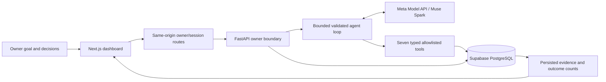

# SoloEstate AI

SoloEstate AI is an AI operating system for independent real estate agents and small property businesses. It connects buyer enquiries, listings, site visits, follow-ups and marketing in one workspace. An owner can give Muse Spark a goal in plain language, inspect the actual records and tool results, and review consequential actions before they proceed.

Built for the Meta Global AI Developer Hackathon, **Indie Developer** track and **Build for Your World** theme. The demo follows one fictional Whitefield listing through an owner-approved appointment, an exported marketing kit, and a live read-only Muse Spark run that finds another matching buyer.

[Watch the 2:13 demo on YouTube](https://youtu.be/YJYJiJZyhCo) · [View the hackathon showcase on X](https://x.com/TheAISuperPower/status/2118115987442831615)

Coding-agent entry point: read [AGENTS.md](AGENTS.md), [project state](docs/PROJECT_STATE.md) and [current handoff](docs/HANDOFF.md) before editing. They identify the canonical reference documents, preservation requirements, actual verification evidence and next proposed increment.

## What you can try

| Route | Workflow |
| --- | --- |
| `/chat` | Capture a buyer's requirements, find catalog matches and review visit availability. |
| `/booking-requests` and `/appointments` | Review a visit request and inspect the persisted booking outcome. |
| `/agent` | Run a natural-language goal with Muse Spark and inspect the validated plan, tool results and any follow-up draft awaiting review. |
| `/growth-engine` | Turn a campaign brief and property facts into draft creatives, captions and a suggested campaign plan for review and export. |

The application is a single-owner prototype. The D2 acceptance covers local fictional-data demos with mocked WhatsApp delivery. Growth Engine-lite prepares marketing materials for review and export. External campaign launch is disabled. The recorded Growth segment shows the voice transcript, labelled creative, grounded copy and export. See [Growth setup and verification](README-GROWTH-ENGINE.md) and [D2 acceptance](docs/phase-d2-verification.md#independent-d2-acceptance--4-november-2026).

## Branch workflow

- `hackathon-submission` is the stable branch for judges and the verified demo. The filmed application baseline is `8f0e479`.
- `dev` is for local development and validation. Review the changes, verify the affected flows, then merge the tested changes into `hackathon-submission` when ready.
- For judging, select `hackathon-submission` or clone with `git clone --branch hackathon-submission https://github.com/naveen1609/soloestate-ai-hackathon.git`.

## Product potential and roadmap

A solo operator often has to answer enquiries during showings, reconstruct buyer preferences across conversations and prepare marketing for each listing. SoloEstate's opportunity is to carry those details forward as shared business records. The owner can spend more of the day on viewings, negotiations and closing, with routine work ready to review in one place. A pilot could measure response time, missed follow-ups and the share of qualified enquiries that result in a visit.

The next milestone is durable, policy-controlled reminders and follow-ups. The longer-term plan adds a fuller sales CRM, specialized assistants, calendar and CRM integrations, multilingual marketing, reporting and separate workspaces for small teams. The backend will continue to own consent, policy enforcement and business writes. See the [product roadmap](docs/ROADMAP.md#product-direction-after-the-hackathon) for the sequence and scope.

## Run locally

Requirements: Python 3.12, Node.js 24/npm, a Meta API key with an allowed model ID, and a Supabase PostgreSQL connection with its CA certificate. The environment used Python 3.12.9 and Node 24.22.0. Docker is optional and not needed for the application.

### 1. Backend setup

Open PowerShell at the repository root.

```powershell
Set-Location .\backend
python -m venv .venv
.\.venv\Scripts\python.exe -m pip install -r requirements-dev.txt
if (-not (Test-Path .env)) { Copy-Item .env.example .env }
```

Configure `backend/.env` locally. Existing installations should keep their current file. Environment variables override this file; a root .env is not loaded.

| Variable | Required value / purpose |
| --- | --- |
| MODEL_API_KEY | Private Meta key |
| MODEL_NAME | Your permitted model ID; demonstrated with muse-spark-1.3 |
| DATABASE_URL | Supabase PostgreSQL URI, with password characters percent-encoded |
| DATABASE_SSLMODE | verify-full |
| DATABASE_SSLROOTCERT | Absolute path to the Supabase CA certificate |
| MIGRATION_DATABASE_URL | Optional setup/admin URI; otherwise DATABASE_URL is used |
| OWNER_API_TOKEN | Generated privately by the owner init command below |
| VISITOR_TOKEN_SECRET | Locally generated secret for website chat. Use `python -c "import secrets; print(secrets.token_urlsafe(32))"`. |

Use the direct connection or session pooler appropriate for your network. See [database setup](docs/database.md) for URI/TLS guidance. Never put secrets in frontend files or NEXT_PUBLIC_ variables. Supabase anon/service-role API keys are not used by this implementation.

Run each command separately and stop on a nonzero exit code:

```powershell
.\.venv\Scripts\python.exe -m scripts.database check
.\.venv\Scripts\python.exe -m scripts.database migrate
.\.venv\Scripts\python.exe -m scripts.database seed
.\.venv\Scripts\python.exe -m scripts.database verify
.\.venv\Scripts\python.exe -m scripts.owner init
.\.venv\Scripts\python.exe -m scripts.demo_preflight
```

The seed adds four fictional leads, three properties and six slots to an empty database. Seeding is repeatable and preserves existing edits, runs and approvals. Preflight performs read-only database and tool checks and validates credential presence. Run a fresh goal in `/agent` to verify model connectivity. Slots can become unavailable or age out.

For `/growth-engine`, run `.\.venv\Scripts\python.exe -m scripts.growth_database migrate` from `backend` after core setup. See [Growth Engine-lite setup](README-GROWTH-ENGINE.md) for details.

Start the API and keep this terminal open:

```powershell
.\.venv\Scripts\python.exe -m uvicorn app.main:app --host 127.0.0.1 --port 8000
```

Expected: application startup complete, listening on http://127.0.0.1:8000.

### 2. Frontend setup

Open another PowerShell terminal at the repository root.

```powershell
Set-Location .\frontend
npm ci
if (-not (Test-Path .env.local)) { Copy-Item .env.example .env.local }
npm run build
npm run start
```

Expected: build completes and Next.js is ready at http://127.0.0.1:3000. Server-only BACKEND_URL defaults to http://127.0.0.1:8000. Use `npm run dev` for development instead of build/start. Stop a production frontend before rebuilding its output.

### 3. Owner sign-in and demo

In a third terminal, from backend:

```powershell
.\.venv\Scripts\python.exe -m scripts.demo_preflight --services
.\.venv\Scripts\python.exe -m scripts.dashboard_login
```

Expected: preflight status ok, then a private URL. Open it within two minutes; it is single-use. The dashboard uses an eight-hour opaque HttpOnly owner session. Sign out from the top bar. Never share the login URL or cookie. Health endpoints establish liveness only.

Follow the [local demo runbook](docs/demo.md) for a read-only goal, a draft-first approval stop and a repeatable replay. Model requests consume credits. The seeded demo week is **2–8 November 2026**, with Bengaluru listings, INR prices and Asia/Kolkata times. Use future slots if that week has passed. Owner-agent follow-ups stay as drafts, and the D2 demonstration uses mocked WhatsApp transport.

Stop servers with Ctrl+C. Nothing starts automatically on reboot.

## How it works



The model proposes actions; Pydantic validates them; the backend executes fixed handlers and returns actual tool results. It cannot approve its own requests, execute arbitrary SQL/shell commands, or invent successful operations. Drafts require explicit review. Booking requires approved unchanged details, a fresh availability check, row locks and database constraints. Final reports use persisted evidence rather than a model-written success narrative.

Read [architecture](docs/architecture.md), [model usage](docs/model-usage.md), [tool contracts](docs/tools.md), [owner/recovery controls](docs/owner-recovery.md), and [limitations](docs/limitations.md).

## Tests and evidence

From backend:

```powershell
.\.venv\Scripts\python.exe -m pytest -q
.\.venv\Scripts\python.exe -m pip check
```

Historical Phase A baseline: **152 passed, 75 skipped** without database opt-ins and **222 passed, 5 skipped** with them, as recorded in [Phase A verification](docs/phase-a-verification.md). Current B2 commands and actual totals are in [B2 verification](docs/phase-b2-verification.md); do not use older counts as the current expected output. Five schema cases still require a separate empty disposable TEST_DATABASE_URL and are not claimed as passed.

From frontend:

```powershell
npm test
npm run lint
npm run typecheck
npm run build
npm run test:e2e
```

Lint/typecheck/build should exit zero. The historical Phase A baseline was **65 unit/component tests**, **7 browser passes and 1 live-model skip**; current B2 executed results are in its verification report. Browser checks require a running configured backend and Microsoft Edge. Each stateful check creates its own fictional scenario and cleans it up; saved demo decisions do not affect assertions. External model calls are mocked in automated backend tests; production has no mock AI fallback.

See [test commands and coverage matrix](docs/testing.md) and the current [Phase A evidence](docs/phase-a-verification.md). [Phase 9](docs/phase-9-verification.md) and [Phase 10](docs/phase-10-verification.md) documents are historical records of their respective implementations.

## Repository map

- `backend/app/services/`: real Meta client; `agent/`: plans, loop, durable steps and leases; `tools/`: typed business handlers.
- `backend/app/owner.py`, `owner_api.py`, `dashboard_sessions.py`: owner decisions, HTTP access and browser sessions.
- `backend/scripts/`: database setup, connectivity checks, owner controls, execution and demo preflight.
- `frontend/src/`: dashboard and fixed same-origin BFF routes; `frontend/e2e/`: browser checks and isolated fixtures.
- `supabase/migrations/`: six immutable checksummed migrations; `seed.sql`: deterministic fictional records.
- `docs/`: setup, architecture, model usage, demo, limitations and executed test evidence.

## If something fails

Share the exact failing command, exit code, test name and sanitized error/terminal output. For a failed goal retain its request key and inspect the saved run before retrying. An unknown response is not confirmed success. For an expired sign-in link generate a new one. For EADDRINUSE stop the conflicting local service. Database/TLS troubleshooting is in [database.md](docs/database.md).

Never share .env contents, API keys, cookies, login URLs or credential-bearing connection strings. No automatic commits, pushes, deployment or hackathon submission are performed.

B1 adds owner-managed journey/contact/handoff controls and activity history to the existing lead detail page. Apply the additive migration before restarting. No channels or delivery are enabled. See [B1 contract](docs/phase-b-plan.md#b1-contract), [roadmap](docs/ROADMAP.md), [decisions](docs/DECISIONS.md) and current [handoff](docs/HANDOFF.md).

B2 adds incomplete lead requirements, purchase timeframe, explicit owner qualification/requalification and explained live property matching on existing records. Blank requirements remain unknown; matching does not book or grant contact permission. Apply migration 0006 before updated startup; no new secrets/dependencies or seed reset. See the [approved B2 contract](docs/phase-b-plan.md#b2-contract--approved-29-october-2026), [verification and walkthrough](docs/phase-b2-verification.md) and [current handoff](docs/HANDOFF.md).

B3 adds owner-managed versioned FAQs with pinned citations and lead-linked simulated conversations with validated grounded answers, explicit unsupported handling, handoff and review. Apply migration 0007 before updated startup; no new secrets/dependencies or seed reset. Simulation is internal and fictional; no channels or delivery exist. See the [approved B3 contract](docs/phase-b-plan.md#b3-contract--approved-29-october-2026), [verification](docs/phase-b3-verification.md) and [current handoff](docs/HANDOFF.md). No later phase is authorized.
