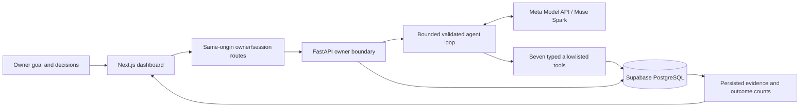

# SoloEstate AI

An owner-directed AI Business Operating System for a one-person real estate company. Give it a business goal; Meta Muse Spark proposes a structured plan, chooses permitted tools, observes real results, adapts to failures and stops for owner approval.

**Phase A Core CRM implemented; phases 1–10 preserved.** The local hackathon application has a responsive dashboard, real Meta integration, persistent Supabase records, approval gates, booking integrity, bounded recovery and automated regression coverage. This is a single-owner demonstration; see [limitations](docs/limitations.md).

Coding-agent entry point: read [AGENTS.md](AGENTS.md), [project state](docs/PROJECT_STATE.md) and [current handoff](docs/HANDOFF.md) before editing. They identify the canonical reference documents, preservation requirements, actual verification evidence and next proposed increment.

## Core CRM update

The overview now shows live business records. Leads, properties and appointments have owner-managed CRM workspaces; the Muse Spark goal dashboard remains at `/agent`. See [Phase A setup and owner walkthrough](docs/phase-a.md), [verification evidence](docs/phase-a-verification.md), and the separate [Phase B proposal](docs/phase-b-plan.md). Restart existing servers after updating.

## Run locally

Requirements: Python 3.12, Node.js 24/npm, a Meta API key with an allowed model ID, and a Supabase PostgreSQL connection with its CA certificate. The environment used Python 3.12.9 and Node 24.22.0. Docker is optional and not needed for the application.

### 1. Backend setup

From PowerShell:

```powershell
Set-Location 'D:\programing_tools\Meta Global AI Developer Hackathon\soloestate-ai-hackathon\backend'
python -m venv .venv
.\.venv\Scripts\python.exe -m pip install -r requirements-dev.txt
if (-not (Test-Path .env)) { Copy-Item .env.example .env }
```

Configure `backend/.env` locally. Existing installations should keep their current file. Environment variables override this file; a root .env is not loaded.

| Variable | Required value / purpose |
| --- | --- |
| MODEL_API_KEY | Private Meta key |
| MODEL_NAME | Your permitted model ID; demonstrated with muse-spark-1.3 |
| DATABASE_URL | Supabase PostgreSQL URI, with password characters percent-encoded |
| DATABASE_SSLMODE | verify-full |
| DATABASE_SSLROOTCERT | Absolute path to the Supabase CA certificate |
| MIGRATION_DATABASE_URL | Optional setup/admin URI; otherwise DATABASE_URL is used |
| OWNER_API_TOKEN | Generated privately by the owner init command below |

Use the direct connection or session pooler appropriate for your network. See [database setup](docs/database.md) for URI/TLS guidance. Never put secrets in frontend files or NEXT_PUBLIC_ variables. Supabase anon/service-role API keys are not used by this implementation.

Run each command separately and stop on a nonzero exit code:

```powershell
.\.venv\Scripts\python.exe -m scripts.database check
.\.venv\Scripts\python.exe -m scripts.database migrate
.\.venv\Scripts\python.exe -m scripts.database seed
.\.venv\Scripts\python.exe -m scripts.database verify
.\.venv\Scripts\python.exe -m scripts.owner init
.\.venv\Scripts\python.exe -m scripts.demo_preflight
```

Expected: status ok, seven migrations, four seeded leads, three properties and six slots. Seeding is repeatable and preserves edits; it does not reset business runs or approvals. Preflight performs real read-only database/tool checks and validates credential presence. It makes **no model call** and does not claim model connectivity. Slots can become unavailable or age out; actual availability is always provisional.

Start the API and keep this terminal open:

```powershell
.\.venv\Scripts\python.exe -m uvicorn app.main:app --host 127.0.0.1 --port 8000
```

Expected: application startup complete, listening on http://127.0.0.1:8000.

### 2. Frontend setup

In another PowerShell terminal:

```powershell
Set-Location 'D:\programing_tools\Meta Global AI Developer Hackathon\soloestate-ai-hackathon\frontend'
npm ci
if (-not (Test-Path .env.local)) { Copy-Item .env.example .env.local }
npm run build
npm run start
```

Expected: build completes and Next.js is ready at http://127.0.0.1:3000. Server-only BACKEND_URL defaults to http://127.0.0.1:8000. Use `npm run dev` for development instead of build/start. Stop a production frontend before rebuilding its output.

### 3. Owner sign-in and demo

In a third terminal, from backend:

```powershell
.\.venv\Scripts\python.exe -m scripts.demo_preflight --services
.\.venv\Scripts\python.exe -m scripts.dashboard_login
```

Expected: preflight status ok, then a private URL. Open it within two minutes; it is single-use. The dashboard uses an eight-hour opaque HttpOnly owner session. Sign out from the top bar. Never share the login URL or cookie. Health endpoints establish liveness only.

Follow the [five-minute demo runbook](docs/demo.md) for a real read-only goal, a draft-first approval stop, recovery evidence and a repeatable replay. Model requests consume credits. The fixed fictional demo week is **2–8 November 2026**, Bengaluru, INR, Asia/Kolkata display time; it is not interpreted as the current week. No customer-message delivery integration exists, so approved messages remain drafts.

Stop servers with Ctrl+C. Nothing starts automatically on reboot.

## How it works



The model proposes actions; Pydantic validates them; the backend executes fixed handlers and returns actual tool results. It cannot approve its own requests, execute arbitrary SQL/shell commands, or invent successful operations. Drafts require explicit review. Booking requires approved unchanged details, a fresh availability check, row locks and database constraints. Final reports use persisted evidence rather than a model-written success narrative.

Read [architecture](docs/architecture.md), [model usage](docs/model-usage.md), [tool contracts](docs/tools.md), [owner/recovery controls](docs/owner-recovery.md), and [limitations](docs/limitations.md).

## Tests and evidence

From backend:

```powershell
.\.venv\Scripts\python.exe -m pytest -q
.\.venv\Scripts\python.exe -m pip check
```

Historical Phase A baseline: **152 passed, 75 skipped** without database opt-ins and **222 passed, 5 skipped** with them, as recorded in [Phase A verification](docs/phase-a-verification.md). Current B2 commands and actual totals are in [B2 verification](docs/phase-b2-verification.md); do not use older counts as the current expected output. Five schema cases still require a separate empty disposable TEST_DATABASE_URL and are not claimed as passed.

From frontend:

```powershell
npm test
npm run lint
npm run typecheck
npm run build
npm run test:e2e
```

Lint/typecheck/build should exit zero. The historical Phase A baseline was **65 unit/component tests**, **7 browser passes and 1 live-model skip**; current B2 executed results are in its verification report. Browser checks require a running configured backend and Microsoft Edge. Each stateful check creates its own fictional scenario and cleans it up; saved demo decisions do not affect assertions. External model calls are mocked in automated backend tests; production has no mock AI fallback.

See [test commands and coverage matrix](docs/testing.md) and the current [Phase A evidence](docs/phase-a-verification.md). [Phase 9](docs/phase-9-verification.md) and [Phase 10](docs/phase-10-verification.md) documents are historical records of their respective implementations.

## Repository map

- `backend/app/services/`: real Meta client; `agent/`: plans, loop, durable steps and leases; `tools/`: typed business handlers.
- `backend/app/owner.py`, `owner_api.py`, `dashboard_sessions.py`: owner decisions, HTTP access and browser sessions.
- `backend/scripts/`: database setup, connectivity checks, owner controls, execution and demo preflight.
- `frontend/src/`: dashboard and fixed same-origin BFF routes; `frontend/e2e/`: browser checks and isolated fixtures.
- `supabase/migrations/`: six immutable checksummed migrations; `seed.sql`: deterministic fictional records.
- `docs/`: setup, architecture, model usage, demo, limitations and executed test evidence.

## If something fails

Share the exact failing command, exit code, test name and sanitized error/terminal output. For a failed goal retain its request key and inspect the saved run before retrying. An unknown response is not confirmed success. For an expired sign-in link generate a new one. For EADDRINUSE stop the conflicting local service. Database/TLS troubleshooting is in [database.md](docs/database.md).

Never share .env contents, API keys, cookies, login URLs or credential-bearing connection strings. No automatic commits, pushes, deployment or hackathon submission are performed.

B1 adds owner-managed journey/contact/handoff controls and activity history to the existing lead detail page. Apply the additive migration before restarting. No channels or delivery are enabled. See [B1 contract](docs/phase-b-plan.md#b1-contract), [roadmap](docs/ROADMAP.md), [decisions](docs/DECISIONS.md) and current [handoff](docs/HANDOFF.md).

B2 adds incomplete lead requirements, purchase timeframe, explicit owner qualification/requalification and explained live property matching on existing records. Blank requirements remain unknown; matching does not book or grant contact permission. Apply migration 0006 before updated startup; no new secrets/dependencies or seed reset. See the [approved B2 contract](docs/phase-b-plan.md#b2-contract--approved-29-october-2026), [verification and walkthrough](docs/phase-b2-verification.md) and [current handoff](docs/HANDOFF.md).

B3 adds owner-managed versioned FAQs with pinned citations and lead-linked simulated conversations with validated grounded answers, explicit unsupported handling, handoff and review. Apply migration 0007 before updated startup; no new secrets/dependencies or seed reset. Simulation is internal and fictional; no channels or delivery exist. See the [approved B3 contract](docs/phase-b-plan.md#b3-contract--approved-29-october-2026), [verification](docs/phase-b3-verification.md) and [current handoff](docs/HANDOFF.md). No later phase is authorized.
