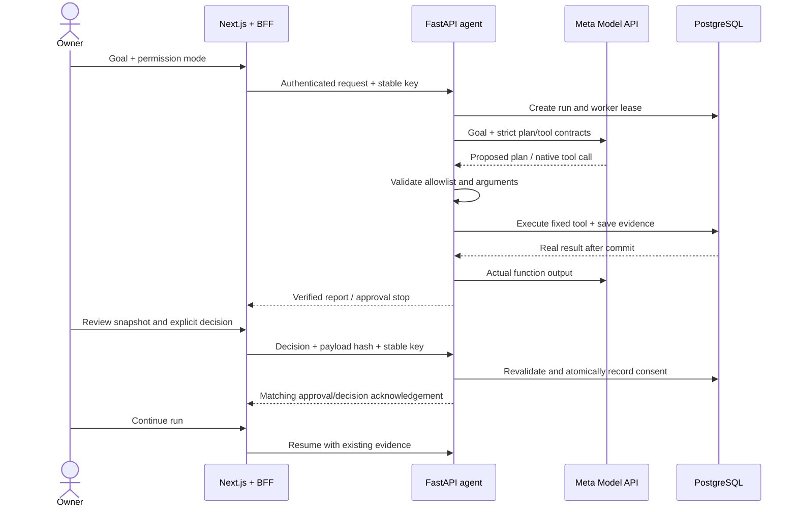

# Architecture

SoloEstate AI is a single-owner local hackathon application: Next.js/TypeScript presents goals and evidence; FastAPI/Pydantic owns execution; Meta Model API supplies planning and tool choices; Supabase PostgreSQL stores business records, consent and execution state.

## Request and execution flow

1. The local owner issues a two-minute single-use link using the private backend credential. The browser exchanges its fragment ticket through Next.js. Only a hashed ticket/session is persisted. Next.js stores the opaque eight-hour session in an HttpOnly, SameSite Strict cookie (Secure over HTTPS).
2. The dashboard submits a goal, permission mode and stable request key through a fixed method/path allowlist. The BFF forwards the session to FastAPI. Same-origin checks protect browser mutations; permanent credentials stay on the backend.
3. A request key binds one goal and permission mode. A new run obtains a worker lease. Meta proposes a JSON plan; Pydantic validates the plan and permitted tool names. Invalid plans get bounded repair feedback.
4. Meta requests native function calls. The backend validates names, arguments and server-owned run context. Unknown tools, SQL, shell execution and model-generated consent are never dispatched.
5. Pending calls and running steps are persisted before execution. A tool transaction commits business writes and successful step evidence together. A failed transaction cannot produce a success report. Actual outputs return to Meta before the next decision.
6. The loop stops for a pending owner decision, validated completion, deadline, provider failure or bounded failure condition. Reports derive steps, counts and owner decisions from PostgreSQL; model-written outcome narratives are not accepted as evidence.
7. The agent execution UI polls every eight seconds. It previews proposed plans, shows real step states, and renders results from successful tool evidence. The separate CRM overview refreshes live business records every fifteen seconds. Empty or missing data is distinguished from confirmed counts. Ambiguous goal/decision retries retain their idempotency keys.

## Business tools and persistence

The registry contains get_leads, get_property_matches, get_available_slots, create_followup_draft, request_approval, book_site_visit and get_run_status. Property matching is deterministic: active inventory within the lead's budget, locality and bedroom criteria. Meta chooses which tools and records to investigate and how to draft; the matching formula is backend code.

Six immutable migrations, together with the setup runner's ledgers, establish fourteen private RLS-enabled tables: leads, properties, visit_slots, runs, run_steps, followup_drafts, approvals, bookings, approval_decisions, dashboard_sessions, crm_operations, lead_activities, schema_migrations and seed_history. Browser policies are absent, PUBLIC access is revoked and no Supabase browser client is used. SQL values are parameterized; identifiers and SQL come from repository constants. Runtime uses direct Psycopg connections and verified TLS. An optional privileged migration connection is separate from the runtime URI.

Approval snapshots bind recipient/content/version or property/price/slot. Owner decisions revalidate current details and atomically write consent, draft state and outcome evidence. Rejection cancels continuation. The model cannot invoke owner decision endpoints. Booking locks the slot, compares the reviewed snapshot and rechecks availability before committing. Nonoverlapping owner slots, a unique confirmed-booking index, composite foreign keys and guard triggers enforce critical invariants independently of the model.

Worker lease tokens fence stale commits. Resume reconciles saved calls and committed steps instead of replaying blind writes. Active leases block takeover; failed/stale work requires explicit recovery. Three resume activations bound a run's lifetime. Only confirmed-rollback SQLSTATE failures receive one extra tool transaction attempt; uncertain network/commit failures are not blindly retried.

## Model and execution bounds

The real Meta service uses the OpenAI-compatible SDK against the fixed Meta endpoint, not an OpenAI-hosted model. Configuration, provider metadata, completed outputs and native calls are validated without requiring OpenAI-only optional usage fields. Provider bodies and credentials are not echoed in errors. Opaque encrypted reasoning is replayed only in memory; provider response IDs/model names are retained as execution metadata.

Default limits are 12 model responses, 16 native calls, 3 failures and 180 seconds per activation, plus a 500KB conversation budget, at most two plan attempts and three later resumes. Provider requests have a separate configurable 30-second default deadline and zero SDK retries. In-flight database writes finish transactionally rather than being abandoned at the agent deadline. See backend/.env.example and [model usage](model-usage.md).

## Deployment boundary

Execution is request-based; there is no background worker, queue, websocket stream or automatic scheduler. Local servers bind loopback. Process interruption leaves durable evidence for bounded owner recovery. HTTPS, managed identity, restricted runtime database privileges, monitoring and deployment-specific origin/proxy configuration require separate deployment work. See [limitations](limitations.md). The project does not claim production readiness or independent semantic certification of every goal.

## Phase A CRM extension

Migration 0004 adds versioned CRM operations and owner provenance without replacing bookings or consent. The current operational overview is `/`; the existing agent UI is `/agent`. Owner CRUD and reviewed appointment operations use authenticated `/owner/crm` routes through the fixed Next.js proxy. They share the same lead/property/slot tables. Owner consent containers have origin=owner, empty model traces and no invented AI steps, and cannot be resumed by the agent. See phase-a.md for transaction/retry rules and phase-b-plan.md for the future customer journey and policy boundaries.

## B1 journey boundary

The existing lead detail page uses owner-only journey/activity APIs on the same records. State changes share CRM operation idempotency and optimistic versions, exclusively lock the lead, and insert activity atomically. Registered customer-directed tools and owner decisions recheck the locked lead's contact/handoff controls; model tools cannot change those controls. Lead, appointment, owner approval, customer permission and future delivery state remain distinct. [B1 contract](phase-b-plan.md#b1-contract), [decisions](DECISIONS.md).

## B2 qualification and shared matching

backend/app/qualification.py owns canonical facts, derived readiness/review, owner confirmation and deterministic property matching shared by owner HTTP and the existing tool handler. The existing lead detail UI exposes incomplete answers, explicit review, stale-review state and requested/actual match explanations. No extra CRM store or model write tool. Models receive typed nullable answers/readiness and cannot confirm qualification. Match results are snapshots tied to lead/property versions; UI suppresses results for another lead or changed lead version.

Owner confirmation and requirement edits reuse row locks, expected versions, stable request keys, CRM operation evidence and lead_activities. PATCH omission differs from explicit NULL and is included in operation identity; pre-B2 lead-edit responses retain a legacy fingerprint replay path. B1 opt-out/handoff, archival, immutable approvals and transactional appointment replacement remain separate controls. [B2 evidence](phase-b2-verification.md).
